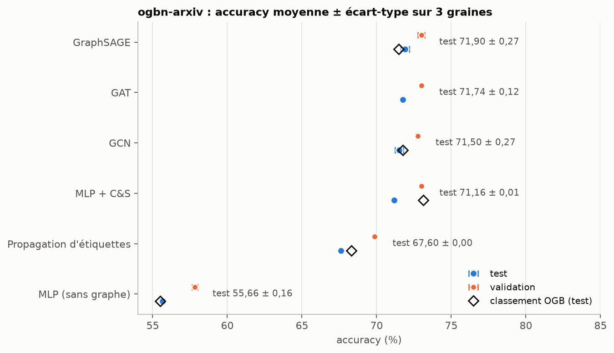
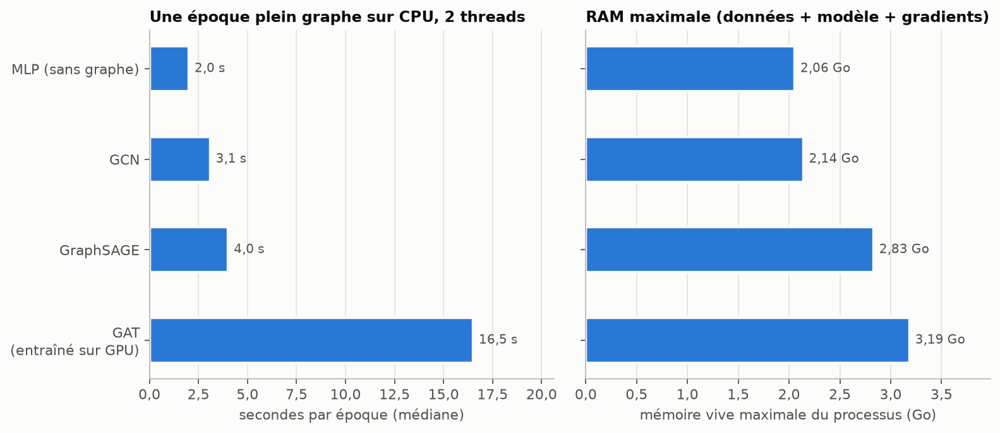
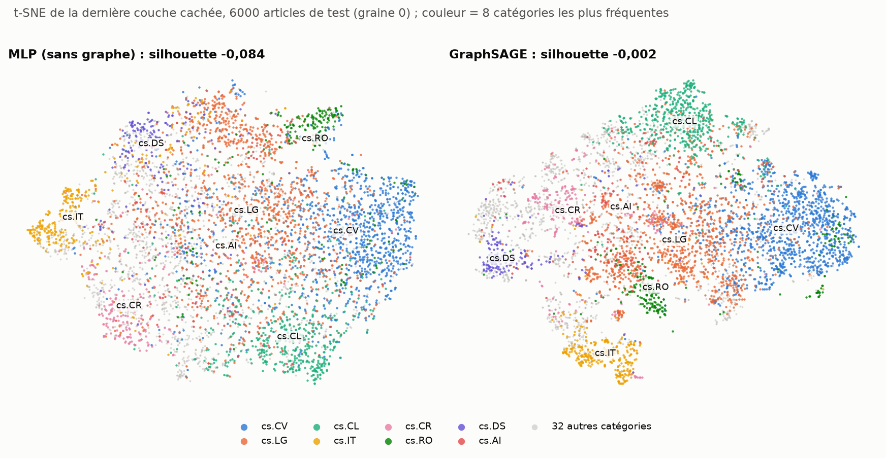
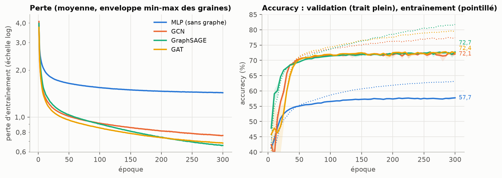

# arxiv-gnn

Classer 169 343 articles d'informatique d'arXiv dans leurs 40 catégories, avec le texte seul puis avec le graphe de leurs citations, et mesurer ce que le graphe apporte sur le protocole officiel de l'Open Graph Benchmark.

Code : https://github.com/pinpin-http/arxiv-gnn

## Résultats

Accuracy sur le découpage officiel, moyenne ± écart-type sur les graines 0, 1 et 2 (tableau complet, configurations et recherche d'hyperparamètres : [`results/summary.md`](results/summary.md), produit par `make report`).

| Méthode | Paramètres | Validation (%) | Test (%) | Classement OGB, test (%) |
|---|---:|---:|---:|---:|
| MLP (texte seul) | 110 120 | 57,81 ± 0,19 | 55,66 ± 0,16 | 55,50 ± 0,23 |
| Propagation d'étiquettes (graphe seul) | 0 | 69,86 | 67,60 | 68,32 |
| GCN | 110 120 | 72,75 ± 0,10 | 71,50 ± 0,27 | 71,74 ± 0,29 |
| GraphSAGE | 218 664 | 72,99 ± 0,24 | 71,90 ± 0,27 | 71,49 ± 0,27 |
| GAT (entraîné sur GPU) | 142 184 | 72,99 ± 0,05 | 71,74 ± 0,12 | pas d'entrée comparable |
| MLP + C&S | 110 120 | 73,01 ± 0,02 | 71,16 ± 0,01 | 73,12 ± 0,12 |

La propagation d'étiquettes est déterministe : ses trois « graines » donnent le même chiffre. Les trois réseaux sur graphe retiennent la même configuration que le MLP (256 neurones, dropout 0,5) ; C&S retient α de correction 0,9 et α de lissage 0,6.



Ce que le graphe apporte. Avec le texte seul, le MLP classe 55,66 % des articles de test. Les citations ajoutent 15,8 à 16,2 points selon le réseau (GCN 71,50, GAT 71,74, GraphSAGE 71,90), et C&S, qui ne fait que diffuser les prédictions du même MLP le long des citations, en ajoute 15,5. Le graphe seul, sans le texte ni apprentissage, fait déjà mieux que le texte seul : la propagation d'étiquettes atteint 67,60 %, 11,9 points au-dessus du MLP. Les écarts-types sont de l'ordre de 0,1 à 0,3 point : avec 3 graines seulement, ils sont estimés grossièrement, mais un écart de 16 points ne dépend pas de cette imprécision.

Entre les méthodes qui combinent texte et graphe, les écarts sont faibles : 0,74 point sépare C&S (71,16) de GraphSAGE (71,90), et GCN, GAT et GraphSAGE tiennent en 0,4 point, soit à peine plus que leurs écarts-types. Le contrôle sur GPU (plus bas) inverse d'ailleurs l'ordre de GCN et GraphSAGE. Sur 3 graines, ces données ne permettent pas de classer GCN, GAT et GraphSAGE entre eux.

Le test porte sur des articles plus récents (2019 et après) que la validation (2018). Toutes les méthodes perdent entre la validation et le test, mais pas toutes autant : environ 1,1 à 1,25 point pour les trois réseaux sur graphe, 1,85 pour C&S et 2,15 pour le MLP. C&S a la validation la plus haute (73,01, à égalité avec les 72,99 de GAT et de GraphSAGE compte tenu des écarts-types) et le test le plus bas des méthodes qui utilisent texte et graphe.

## La question

Un article cite des articles proches de son sujet. Si l'on connaît déjà le texte d'un article (titre et résumé), que gagne-t-on à regarder aussi qui il cite et qui le cite ? Pour répondre, on compare sur les mêmes données :

- un MLP, qui ne voit que le texte de chaque article ;
- la propagation d'étiquettes, qui ne voit que le graphe et les étiquettes connues, sans apprentissage ;
- trois réseaux de neurones sur graphe, GCN, GraphSAGE et GAT, qui combinent le texte d'un article et celui de ses voisins ;
- Correct & Smooth (C&S), qui part des prédictions du MLP et les corrige en les diffusant le long des citations.

## Données

[ogbn-arxiv](https://ogb.stanford.edu/docs/nodeprop/#ogbn-arxiv) (Open Graph Benchmark), téléchargé par `make data` avec le package `ogb` dans `data/` (ignoré par git, environ 81 Mo compressés).

- **Graphe** : les citations entre les articles d'informatique d'arXiv indexés par Microsoft Academic Graph (MAG), 169 343 nœuds et 1 166 243 arêtes orientées.
- **Caractéristiques** : un vecteur de 128 dimensions par article, moyenne des plongements word2vec des mots du titre et du résumé.
- **Étiquettes** : 40 catégories (cs.AI, cs.LG, cs.CV…).
- **Découpage officiel par année** : entraînement sur les articles publiés jusqu'en 2017 (90 941), validation sur 2018 (29 799), test à partir de 2019 (48 603). Le test porte donc sur des articles plus récents que tout ce qui a servi à l'entraînement.
- **Licence** : ODC-BY (Open Data Commons Attribution), indiquée par OGB pour ogbn-arxiv sur la page du jeu de données. La source est MAG (Wang et al., « Microsoft Academic Graph: When experts are not enough », *Quantitative Science Studies*, 2020) ; la page OGB ne mentionne pas de licence distincte pour MAG.

Comme dans les exemples officiels d'OGB, le graphe est rendu symétrique (une citation relie les deux articles dans les deux sens) : 2 315 598 arêtes orientées après suppression des doublons, degré moyen 13,7, médian 6, maximum 13 161, aucun nœud isolé.

## Méthode

**Protocole.** Découpage et `Evaluator` officiels d'OGB (accuracy). Les étiquettes d'entraînement sont les seules à entrer dans la perte, dans la propagation d'étiquettes et dans C&S. La validation sert à choisir l'époque et la configuration. Le test n'est calculé qu'en campagne finale, et le chiffre rapporté est celui de l'évaluation qui maximise la validation (même règle que les exemples OGB). Des tests vérifient que remplacer toutes les étiquettes de test par du bruit ne change ni l'entraînement, ni l'époque retenue, ni la configuration retenue.

**Modèles.** Le MLP, GCN et GraphSAGE reprennent l'architecture des exemples officiels d'OGB, et GAT le même schéma : 3 couches, BatchNorm, ReLU et dropout entre les couches, Adam avec un taux d'apprentissage de 0,01, entraînement plein graphe (tout le graphe à chaque époque).

| Méthode | Ce qu'elle voit | Implémentation |
|---|---|---|
| MLP | le texte de l'article | `torch.nn` |
| Propagation d'étiquettes | le graphe et les étiquettes d'entraînement | Y ← α·ÂY + (1 − α)·Y₀, Â = D^-1/2 A D^-1/2, 50 itérations ; vérifiée contre `LabelPropagation` de PyG |
| GCN | texte de l'article et de ses voisins | `GCNConv` de PyG sur  = D^-1/2 (A + I) D^-1/2 en CSR |
| GraphSAGE | idem, agrégation par moyenne | `SAGEConv` de PyG (moyenne des voisins) |
| GAT | idem, voisins pondérés par une attention apprise | `SparseGATConv` (ce dépôt), 4 têtes qui se partagent la largeur |
| MLP + C&S | prédictions du MLP, graphe, étiquettes d'entraînement | `CorrectAndSmooth` de PyG, 50 itérations de correction et 50 de lissage |

Toutes les méthodes ont le même budget d'hyperparamètres : 4 configurations chacune, jugées sur la validation avec la graine 0.

- réseaux : largeur {128, 256} × dropout {0,25 ; 0,5}, 300 époques ;
- propagation d'étiquettes : α ∈ {0,5 ; 0,75 ; 0,9 ; 0,99} ;
- C&S : α de correction {0,5 ; 0,9} × α de lissage {0,6 ; 0,9}, sur les prédictions du MLP retenu.

**Graines et calcul.** La configuration retenue est relancée avec les graines 0, 1 et 2 ; on rapporte la moyenne et l'écart-type non biaisé, comme OGB. La validation est évaluée toutes les 5 époques. La graine 0 de la campagne finale reprend l'essai correspondant de la recherche.

MLP, propagation d'étiquettes, C&S, GCN et GraphSAGE sont calculés sur CPU (AMD Ryzen 5 5600G, 12 threads logiques), en float32, avec 2 threads par processus (`torch.set_num_threads(2)`). La campagne a tourné le 7 novembre 2026 avec trois processus en parallèle, sans plafond CPU, sur une machine partagée avec d'autres tâches ; la dernière graine de GraphSAGE a tourné seule. Les durées enregistrées dans les JSON de `results/` dépendent donc de la charge du moment et ne se comparent pas entre elles : les temps cités plus bas viennent de `make bench`.

Une époque de GAT prend 16,5 s sur 2 threads CPU. GAT a donc été entraîné sur un GPU AMD Radeon RX 9060 XT (ROCm 7.2, `torch 2.11.0+rocm7.2`), en float32 et avec le même protocole que les autres réseaux : même grille de 4 configurations jugées sur la validation avec la graine 0, mêmes graines 0, 1 et 2, même évaluation. Sur GPU, l'option `--precision auto` choisit la précision mixte float16 ; elle a été forcée à `fp32` pour rester dans les conditions numériques du CPU.

**Détails d'implémentation.**

- Matrices d'adjacence en CSR avec indices int32 (`torch.sparse_csr_tensor`), une multiplication creuse par couche.
- Comme le graphe est symétrique, la rétropropagation de ·X réutilise  au lieu de calculer Âᵀ à chaque pas (`sym_spmm`, testé contre un calcul dense).
- GAT est implémenté (`SparseGATConv`) avec une attention fusionnée qui ne garde aucun tenseur par arête, testé contre `GATConv` de PyG (sorties et gradients) et par différences finies.

## Contrôle CPU/GPU

Pour vérifier que les chiffres de GAT, obtenus sur GPU, se comparent à ceux des autres réseaux, obtenus sur CPU, GCN et GraphSAGE ont été refaits en entier sur le même GPU, en float32 : recherche des 4 configurations puis graines 0, 1 et 2 (`results/gpu_check/`).

| Méthode | Configuration retenue | Validation CPU (%) | Validation GPU (%) | Test CPU (%) | Test GPU (%) | Écart de test, GPU moins CPU |
|---|---|---:|---:|---:|---:|---:|
| GCN | identique (256 neurones, dropout 0,5) | 72,75 ± 0,10 | 72,93 ± 0,21 | 71,50 ± 0,27 | 71,92 ± 0,18 | +0,42 point |
| GraphSAGE | identique (256 neurones, dropout 0,5) | 72,99 ± 0,24 | 72,90 ± 0,20 | 71,90 ± 0,27 | 71,53 ± 0,39 | -0,37 point |

La recherche retient la même configuration sur les deux matériels. Les moyennes de test bougent d'environ 0,4 point, dans un sens pour GCN et dans l'autre pour GraphSAGE, ce qui est de l'ordre d'un à deux écarts-types : changer de matériel (le calcul sur GPU n'est en outre pas déterministe) pèse à peu près autant que changer de graine. Le chiffre de GAT se compare donc aux autres réseaux avec une incertitude de quelques dixièmes de point.

## Comparaison au classement OGB

Les chiffres de référence ont été relevés le 7 novembre 2026 sur le [classement d'ogbn-arxiv](https://ogb.stanford.edu/docs/leader_nodeprop/#ogbn-arxiv) (`src/arxiv_gnn/reference.py`). Le classement exige 10 graines, contre 3 ici, et les exemples officiels d'OGB entraînent 500 époques, contre 300 ici. Pour le MLP, GCN et GraphSAGE, l'architecture et le nombre de paramètres sont les mêmes que dans les lignes de l'équipe OGB (110 120, 110 120 et 218 664).

- MLP : 55,66 ± 0,16 contre 55,50 ± 0,23.
- GCN : 71,50 ± 0,27 contre 71,74 ± 0,29.
- GraphSAGE : 71,90 ± 0,27 contre 71,49 ± 0,27.

Les trois écarts restent sous un demi-point, dans les deux sens, à un ou deux écarts-types : la reproduction est fidèle à la précision que permettent 3 graines.

- Propagation d'étiquettes : 67,60 contre 68,32. Les deux calculs sont déterministes, l'écart de 0,72 point vient donc du réglage. Ici α est choisi parmi 4 valeurs avec la normalisation symétrique D^-1/2 A D^-1/2 ; le réglage de l'entrée publiée n'a pas été vérifié.
- MLP + C&S : 71,16 contre 73,12, soit 2 points de moins, l'écart le plus net. Plusieurs différences avec la configuration publiée par les auteurs de C&S ([CUAI/CorrectAndSmooth](https://github.com/CUAI/CorrectAndSmooth), `gen_models.py` et `run_experiments.py`) peuvent l'expliquer. En plus des 128 caractéristiques d'OGB, leur MLP reçoit, concaténés et standardisés, des plongements spectraux et un lissage des caractéristiques par diffusion sur le graphe. Le nombre de paramètres de leur ligne le confirme : 175 656 = 110 120 + 256 × 256, soit une entrée de 384 dimensions au lieu de 128. Leur base voit donc déjà le graphe, alors qu'ici C&S part d'un MLP qui ne voit que le texte. Ils utilisent aussi d'autres normalisations du graphe pour la correction et pour le lissage (D^-1 A et A D^-1 au lieu de D^-1/2 A D^-1/2) et des α réglés finement (environ 0,98 et 0,76, contre 0,9 et 0,6 retenus ici sur une grille de 4 points dont 0,9 est le bord). Comme ici, seules les étiquettes d'entraînement servent à la correction et au lissage. Une ligne du classement part, comme ici, des seules caractéristiques d'OGB, d'après son nombre de paramètres : « Plain Linear + C&S » (5 160 = 128 × 40 + 40) obtient 71,26 ± 0,01, proche de nos 71,16. Leur calcul n'a pas été refait ici : la part de chaque différence dans les 2 points reste une hypothèse.
- GAT : le classement n'a pas de ligne « GAT » simple. Toutes ses entrées GAT sont des variantes avec des astuces en plus (réutilisation des étiquettes, normalisation de l'adjacence, FLAG, C&S, distillation) et 1,4 à 1,6 million de paramètres pour les plus simples, contre 142 184 ici. Par exemple, GAT+FLAG obtient 73,71 ± 0,13 avec 1 628 440 paramètres. Elles ne sont pas directement comparables à notre GAT, et le tableau laisse la case vide.

Le classement contient aussi des GCN et GraphSAGE réglés plus finement et plus gros (73,60 ± 0,18 avec 1 463 336 paramètres et 72,95 ± 0,31 avec 1 727 272 paramètres, Luo et al., 2024) : les architectures d'OGB reprises ici ne sont pas le plafond de ces modèles.

## Coût du calcul sur CPU

`make bench` mesure une époque plein graphe (passage avant sur les 169 343 nœuds, perte, rétropropagation, pas d'Adam) dans un sous-processus neuf par modèle, sur 2 threads, et note la mémoire vive maximale du processus. La mesure a tourné le 7 novembre 2026 de 19 h 25 à 19 h 29, sur la même machine (Ryzen 5 5600G, 12 threads logiques), sans plafond CPU et sans autre calcul de cette expérience en parallèle. La charge moyenne du système sur une minute, notée avant et après chaque mesure dans `results/bench.json`, est restée entre 1,16 et 3,16 pour 12 threads logiques, mesures comprises. Cette machine n'a pas de sonde thermique lisible par `thermal.py` : aucun ralentissement thermique n'a pu être détecté ni écarté.



| Méthode | s par époque (médiane) | RAM max (Go) |
|---|---:|---:|
| MLP | 2,02 | 2,06 |
| GCN | 3,10 | 2,14 |
| GraphSAGE | 4,02 | 2,83 |
| GAT | 16,51 | 3,19 |
| Propagation d'étiquettes | 2,1 (calcul complet) | 0,91 |
| C&S (sans le MLP) | 4,0 (calcul complet) | 0,91 |

Le chargement des données occupe à lui seul environ 0,91 Go. Le MLP prend déjà 2 s par époque, parce que l'époque passe sur tous les nœuds ; le passage de message ajoute 1,1 s pour GCN et 2 s pour GraphSAGE, qui calcule deux transformations par couche (d'où ses 218 664 paramètres). GAT coûte environ 4 fois GraphSAGE : son attention est calculée arête par arête, sur les 2,3 millions d'arêtes orientées et pour 4 têtes. La médiane de GAT porte sur 3 époques mesurées après une époque d'échauffement, celle des autres réseaux sur 5.

Sur le GPU, en float32, l'époque d'entraînement prend 0,84 s pour GCN, 1,00 s pour GraphSAGE et 1,60 s pour GAT (médianes des graines, `results/summary.md`). Ces temps viennent des campagnes d'entraînement, pas de `make bench`, et ne donnent qu'un ordre de grandeur.

## Représentations apprises



La figure projette avec t-SNE la dernière couche cachée de 6 000 articles de test (graine 0), pour le MLP et pour GraphSAGE, retenu sur la validation entre les deux réseaux sur graphe entraînés sur CPU (GAT, à égalité avec lui en validation, n'est pas représenté). Les couleurs marquent les 8 catégories les plus fréquentes, les 32 autres sont en gris.

Avec le texte seul, quelques catégories forment déjà des zones (cs.CV, cs.CL, cs.IT, cs.CR, cs.RO), mais cs.LG et cs.AI s'étalent au centre, mêlées aux autres. Avec GraphSAGE, cs.CL, cs.CV, cs.IT, cs.DS et cs.RO forment des groupes plus serrés et plus nets ; cs.LG reste au centre et cs.AI reste mêlé à cs.LG, ce qui correspond à des sujets voisins qui se citent entre eux. Le score de silhouette, calculé sur la couche cachée elle-même (distance cosinus, 40 catégories, 3 000 points tirés au hasard), passe de -0,084 à -0,002 : la séparation progresse, mais les catégories se recouvrent toujours largement dans les deux cas. Les distances d'une projection t-SNE ne se lisent qu'à l'échelle locale.



Les courbes d'apprentissage montrent la même hiérarchie. La perte du MLP plafonne bien au-dessus de celle des réseaux sur graphe. La validation des trois réseaux sur graphe atteint un plateau autour de 72 % vers la centième époque, pendant que l'accuracy d'entraînement continue de monter (jusqu'à environ 82 % pour GraphSAGE) : l'écart se creuse sans que la validation ne baisse. L'époque retenue tombe souvent tard : entre 260 et 300 pour GraphSAGE, entre 205 et 300 pour GAT, entre 245 et 290 pour GCN.

## Limites

- 3 graines au lieu des 10 du classement OGB. Les écarts-types sont estimés sur 3 valeurs et donc imprécis ; ils suffisent pour l'écart de 16 points entre texte seul et texte avec graphe, pas pour départager GCN, GAT et GraphSAGE.
- 300 époques au lieu de 500. Plusieurs graines retiennent l'une des dernières évaluations (époque 295 ou 300) : un entraînement plus long gagnerait peut-être un peu.
- Budget d'hyperparamètres réduit (4 configurations, graine 0 seulement), le même pour toutes les méthodes. Pour C&S, la configuration retenue est au bord de la grille.
- C&S part ici d'un MLP sur les seules caractéristiques d'OGB, alors que les auteurs enrichissent l'entrée de leur base : le chiffre obtenu vaut pour ces conditions-là.
- GAT a été entraîné sur GPU, les autres réseaux sur CPU. Le contrôle sur GCN et GraphSAGE montre des écarts d'environ 0,4 point entre les deux matériels.
- Les durées des campagnes ont été mesurées sur une machine partagée et chargée ; seuls les temps de `make bench` se comparent entre modèles, et ils ont été mesurés sans sonde thermique.
- Un seul jeu de données, avec des caractéristiques textuelles simples (moyenne de plongements word2vec) : le gain apporté par le graphe serait probablement plus faible avec une meilleure représentation du texte. Dans le classement, « GIANT-XRT+MLP », un MLP sur des représentations apprises à partir du texte brut, atteint 73,06 ± 0,11 sans passage de message, et « GIANT-XRT+GraphSAGE » 74,35 ± 0,14 avec. Ces représentations sont toutefois apprises en prédisant les voisins de chaque article dans le graphe, qui y est donc déjà présent.

## Relancer

```bash
make install          # uv sync --frozen --extra cpu (torch CPU, dépendances épinglées)
make data             # téléchargement d'ogbn-arxiv dans data/
make train MODEL=sage # recherche d'hyperparamètres puis graines 0, 1, 2 (MODEL : mlp, lp, gcn, sage, gat, cs)
make experiments      # toutes les méthodes sauf GAT, dans l'ordre lp, mlp, cs, gcn, sage
make bench            # temps par époque et RAM maximale sur CPU
make figures          # PNG dans docs/
make report           # tableaux de results/summary.md
make test             # tests pytest sur petits graphes synthétiques
```

`make train MODEL=cs` suppose que le MLP a déjà tourné. Les campagnes reprennent là où elles s'étaient arrêtées : chaque essai et chaque graine sont écrits dans `results/` dès qu'ils finissent.

Sur GPU, l'option `--precision` (variable `PRECISION` du Makefile) vaut `auto` par défaut, c'est-à-dire précision mixte float16 sur GPU et float32 sur CPU ; les résultats publiés sur GPU utilisent `fp32`.

```bash
# GPU AMD (ROCm 7.2) : GAT, comme pour les résultats publiés
make install TORCH=rocm
make train MODEL=gat TORCH=rocm DEVICE=cuda PRECISION=fp32
# contrôle CPU/GPU, écrit à part dans results/gpu_check/
ARXIV_GNN_RESULTS=results/gpu_check ARXIV_GNN_CHECKPOINTS=checkpoints/gpu_check \
  make train MODEL=gcn TORCH=rocm DEVICE=cuda PRECISION=fp32
# GPU NVIDIA (CUDA 12.8)
make install TORCH=cu128
make train MODEL=gat TORCH=cu128 DEVICE=cuda PRECISION=fp32
```

PyTorch ROCm se présente comme un périphérique `cuda`, d'où `DEVICE=cuda` dans les deux cas. `make install TORCH=rocm` remplace le torch CPU du venv ; les résultats publiés ont été calculés dans un venv séparé (`.venv-rocm`), avec le torch épinglé dans `uv.lock` pour cet extra (`2.11.0+rocm7.2`).

## Organisation du code

```
src/arxiv_gnn/
  data.py       chargement OGB, symétrisation, matrices CSR, graphe synthétique des tests
  models.py     MLP, GCN, GraphSAGE, GAT (attention fusionnée), propagation d'étiquettes, C&S
  train.py      boucle d'entraînement, recherche sur la validation, campagnes multi-graines
  evaluate.py   Evaluator OGB, moyenne et écart-type
  bench.py      temps par époque et RAM maximale
  figures.py    figures de docs/
  report.py     tableau récapitulatif
  reference.py  chiffres publiés du classement OGB
tests/          formes de sortie, GCN contre calcul dense, GAT contre PyG, graines, fuite de test, propagation
```

## Licence

Code sous licence MIT (voir `LICENSE`). Les données ogbn-arxiv restent sous licence ODC-BY.
